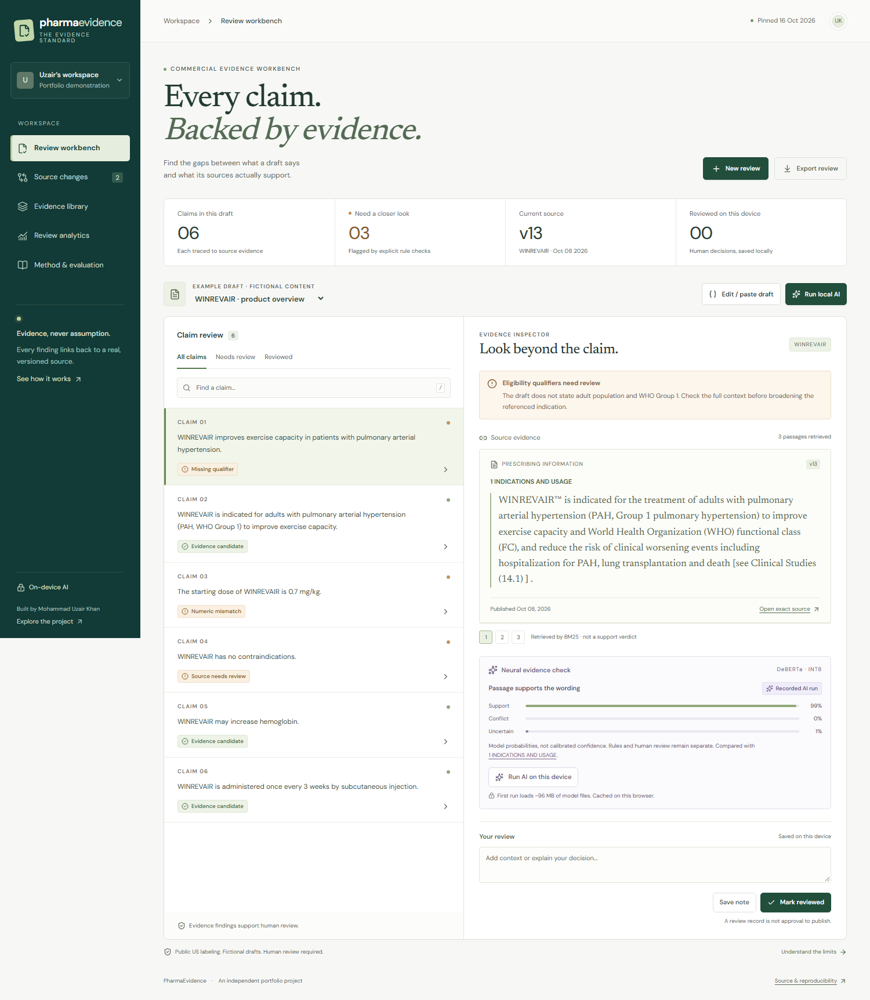
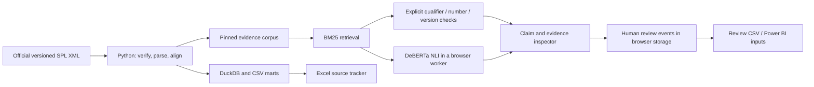

# PharmaEvidence

**Every claim. Backed by evidence.**

A pharmaceutical claim-review workbench for commercial operations: inspect a draft against real, versioned labeling, run a neural evidence check on your own device, and follow a source change to the content that needs another review.

**Live demo: https://pharma-evidence.vercel.app**



## Try the actual workflow

1. Open the fictional WINREVAIR draft. Its first claim drops eligibility qualifiers; its third swaps a starting dose; its fourth cites an outdated contraindications assertion.
2. Select a claim. Read the exact source passage, inspect the explicit finding, and compare it with the separately labelled neural result.
3. Click **Run local AI**. The real, pinned DeBERTa model downloads from this site and runs in a Web Worker. Draft text is not sent to an inference provider. First use loads about 96 MB of model files plus the runtime; subsequent use is browser-cached. Canceling terminates the worker.
4. Add a note and mark a claim reviewed. Reload: the record persists on this device. Export it as CSV.
5. Open **Source changes**, load the clearly fictional historical review example, and reopen the affected review. The audit trail preserves the older evidence ID and the newer source version.
6. Inspect **Method & evaluation**, including the dose mutation the neural model missed.

On a phone, selecting a claim brings its inspector into view. The navigation menu exposes every view, and `/` focuses claim search.

## The real data

Four genuine DailyMed SPL XML documents, with identity and version assertions:

| Product | Earlier version | Current snapshot | Application |
| --- | --- | --- | --- |
| WINREVAIR / sotatercept-csrk | v8, 24 Mar 2026 | v13, 8 Oct 2026 | BLA761363 |
| KEYTRUDA / pembrolizumab, intravenous | v219, 8 Dec 2025 | v228, 24 Jul 2026 | BLA125514 |

The pipeline extracts **181 sections and 2,309 short evidence passages**. Publication dates come from each product's version history; effective dates are retained separately. Application identifiers are verified in the XML and reconciled with downloaded Drugs@FDA records. Current FDA label PDFs and hashes are retained as separate reference documents.

**Authority matters:** DailyMed contains manufacturer-submitted in-use labeling, which can differ from FDA-approved labeling. Full text equivalence is not asserted. This is a pinned 16 October 2026 snapshot, not a real-time regulatory monitor. US sources do not establish suitability for UAE promotional use.

Raw XML bytes are preserved with SHA-256 hashes. `.gitattributes` excludes the raw XML from newline conversion. Section identity uses chapter plus normalized title so renumbering within a chapter does not create a false new section. Word-level diffs preserve source wording; simple cross-reference/format-only normalization is reported separately.

## What the evaluation found

The frozen authored fixture has **120 claims across 20 fact families**. Related variants stay together: **72 development cases and 48 held-out cases**. Thresholds were fixed before inference. Labels were authored against the linked source passages, without independent clinical/regulatory adjudication.

| Held-out binary task | Correct / 48 | Unsupported claims missed / 32 | Supported claims flagged / 16 |
| --- | ---: | ---: | ---: |
| Explicit rules | 40 | 8 | 0 |
| Retrieval overlap | 19 | 29 | 0 |
| Neural NLI | 47 | 1 | 0 |
| Rules + neural | 48 | 0 | 0 |

The neural model treated a **7 mg/kg** target-dose mutation as supported by a passage stating **0.7 mg/kg**. The numeric rule caught it. This failure is visible in the app; source existence and high entailment scores do not establish medical accuracy.

These are correlated, deliberately constructed examples from two products, including obvious mutations. The combined result is **not** a general accuracy, safety or compliance claim. The app reports raw cases, counts, intervals and limits. Its UI keeps evidence candidates, rule findings, neural scores and human decisions distinct.

- Frozen fixture and split: [`data/evaluation/benchmark.json`](data/evaluation/benchmark.json), [`freeze.json`](data/evaluation/freeze.json)
- Case-level predictions: [`data/evaluation/predictions.json`](data/evaluation/predictions.json)
- Public report: [`public/data/evaluation.json`](public/data/evaluation.json)
- Recorded example scores: [`public/data/demo-inference.json`](public/data/demo-inference.json), explicitly labelled in the UI and matched by exact text and evidence ID

## Architecture



Next.js 16 / TypeScript for the interface; Python, DuckDB and openpyxl for ingestion and exports; Transformers.js / ONNX Runtime for local inference. The neural model is pretrained, not fine-tuned on these fixtures and not a generative chatbot or an autonomous approval agent.

Each review event records the claim text, source version, selected evidence/section, source hash, action, note and timestamp. Storage is browser-local, with no shared identities or enterprise audit certification. Review exports neutralize spreadsheet-formula injection. Source strings are rendered as text, not HTML. Model inputs cannot execute tools or change a review decision.

The model is `Xenova/nli-deberta-v3-xsmall`, pinned to revision `2a4f614a701367a02d51389039afc998faeda637`, with INT8 weights. Every model file is hash-checked during build. Revisioned model paths prevent mixing cached weights across future updates. No external model host, CDN font or analytics service is contacted by the running app; CSP restricts connections to the site itself.

## Run and reproduce

Requires Node 24 and Python 3.12+.

```bash
npm ci
pip install -r requirements.txt
python pipeline/build.py       # verify original sources; build corpus, CSVs and local DuckDB
python pipeline/benchmark.py   # refuses a changed frozen fixture
python pipeline/exports.py     # Excel source tracker and downloadable CSVs
npm run build                 # fetch/hash-check pinned weights; build isolated worker and app
npm run start                 # localhost:3070
npm run evaluate              # actual local CPU model evaluation; no API key
npm run lint
npm run typecheck
npm test
npm run e2e
```

`python pipeline/fetch.py` re-downloads the exact pinned official archive versions and refuses changed hashes. Model weights are reproducibly fetched by `scripts/prepare-model.mjs`; they are not committed to Git. Production builds require network access to the pinned Hugging Face artifacts. The app itself loads them from its own origin.

Browser checks run against the built app, including real WASM neural inference, source links, CSV/Excel downloads, local persistence, the source-change walkthrough, 320/390/768px layouts and accessibility on all five views. Set `BASE_URL` to test a hosted deployment. See [the workflow](.github/workflows/ci.yml).

Power BI imports and measures are documented in [`powerbi/`](powerbi/README.md). This delivers a reconciled Excel workbook, CSV marts and a documented Power BI model; it does not claim that a PBIX report was validated in Power BI Desktop.

The Excel workbook was opened and recalculated in Excel 16 through COM. Its eight dashboard formulas returned 4 versions, 43 modified sections, 4 added, 1 removed, 42 unchanged, 3 reference-only changes, 120 fixture cases and 48 held-out cases. This check caught and fixed overlapping worksheet/table filters that XML-only validation missed.

## Limits to keep visible

- A supported passage can omit a material restriction elsewhere; highest entailment among two retrieved candidates can hide a conflict. Full-document and multi-source review are outside this prototype.
- Only selected explicit rules exist. A rule pass is an evidence candidate, never automatic support or approval.
- The corpus covers two US product formulations. Other products, jurisdictions and a complete current evidence base require separate source validation.
- Authored review examples and dependencies are fictional, not internal MSD records or approved content.
- Local storage can be edited or cleared. Export to retain a record. Multi-user access, authentication, durable hosted storage, PDF OCR and autonomous monitoring are not implemented.
- This app has no affiliation with MSD or Veeva and is not medical advice or regulatory approval software.

Built by Mohammad Uzair Khan as an independent commercial Data & AI portfolio project. Source references and intended internship fit are in [`docs/project-context.md`](docs/project-context.md).
